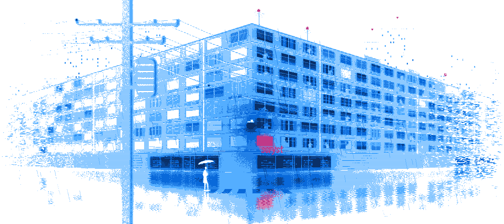

  <picture>
    <source media="(max-width: 600px) and (prefers-color-scheme: dark)" srcset="https://raw.githubusercontent.com/scryst/scryst/night/night-phone-dark.webp">
    <source media="(max-width: 600px)" srcset="https://raw.githubusercontent.com/scryst/scryst/night/night-phone-light.webp">
    <source media="(prefers-color-scheme: dark)" srcset="https://raw.githubusercontent.com/scryst/scryst/night/night-dark.webp">
    
  </picture>

