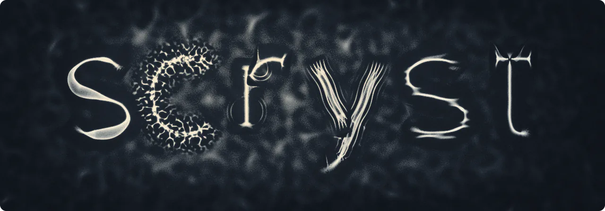

  <picture>
    <source media="(prefers-color-scheme: dark) and (prefers-reduced-motion: reduce)" srcset="banner/scryst-dark.png">
    <source media="(prefers-reduced-motion: reduce)" srcset="banner/scryst-light.png">
    <source media="(prefers-color-scheme: dark)" srcset="banner/scryst-dark.webp">
    
  </picture>

